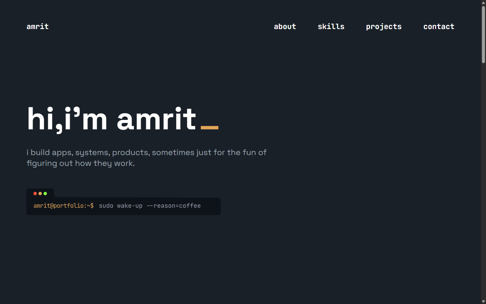
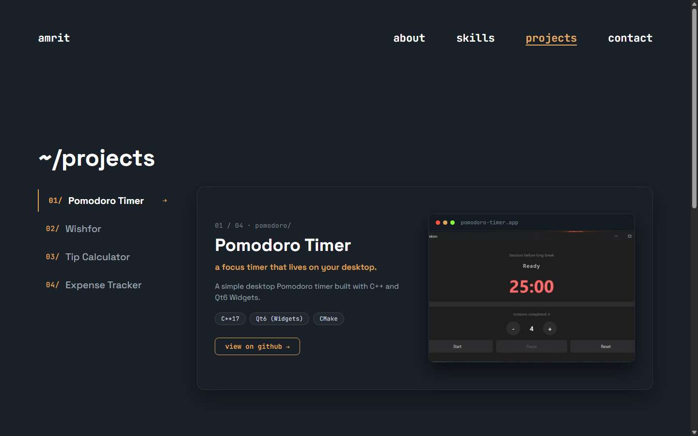

# amrit.portfolio

> Minimal, terminal-inspired developer portfolio. Pure vanilla web — zero frameworks, zero dependencies.

**[Explore Live Demo →](https://amrit-kumar.vercel.app/)**

---

## Preview





---

## Built With

- **Stack:** HTML5 · CSS3 · Vanilla JavaScript (ES6+)
- **Typography:** Space Grotesk · JetBrains Mono
- **Design:** Terminal dark aesthetic (`#1A2028` · `#E0A458`)
- **Zero Build:** No bundlers, npm packages, or compilation steps

---

## Featured Projects

| Project | Tech Stack | Repository |
| :--- | :--- | :--- |
| **Pomodoro Timer** | C++17 · Qt6 Widgets · CMake | [amrit978/pomodoro-timer](https://github.com/amrit978/pomodoro-timer) |
| **Wishfor** | Next.js · TypeScript · Tailwind CSS | [amrit978/Wishfor](https://github.com/amrit978/Wishfor) |
| **Tip Calculator** | HTML5 · CSS3 · JavaScript | [amrit978/Tip-Calculator](https://github.com/amrit978/Tip-Calculator) |
| **Expense Tracker** | Python · Flask · SQLite | [amrit978/Expense-Tracker](https://github.com/amrit978/Expense-Tracker) |

---

## Run Locally

```bash
git clone https://github.com/amrit978/Portfolio-main.git
cd Portfolio-main
# Open index.html directly, or serve with Python:
python -m http.server 3000
```

---

## Contact

- **Email:** [itsmeamrit@proton.me](mailto:itsmeamrit@proton.me)
- **GitHub:** [@amrit978](https://github.com/amrit978)
- **LinkedIn:** [Amrit Kumar](https://www.linkedin.com/in/amrit-kumar-319780329/)
